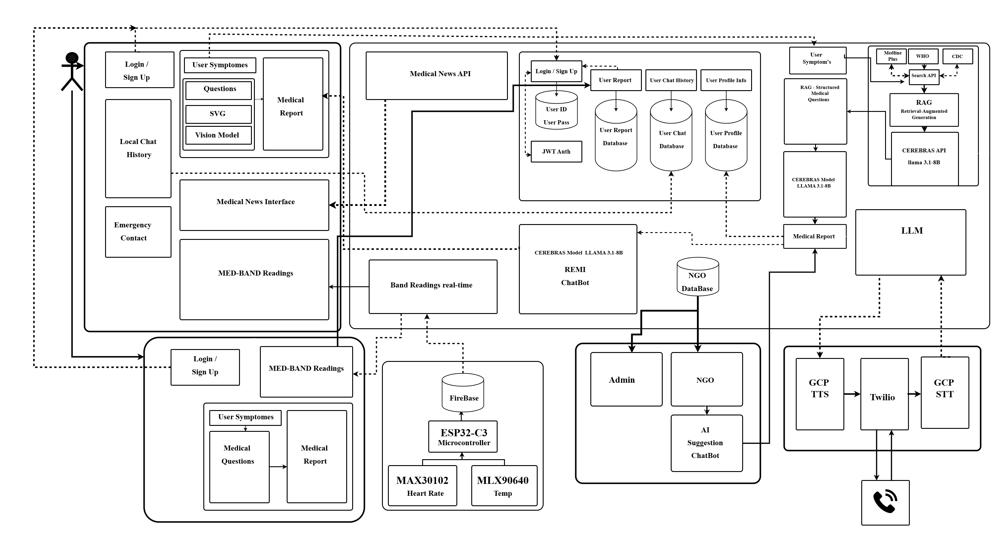

# Healthcare Chatbot Backend

A FastAPI backend for a medical assessment chatbot. It runs an adaptive questionnaire, asks symptom-specific follow-up questions, and generates a structured medical report with an LLM (Cerebras, Llama 3.1-8B). The same backend serves the mobile app, the kiosk website, a chatbot (Remy) and a voice agent.

## Features

- Adaptive questionnaire: 26 questions plus 2 conditional ones for female patients, each tagged `is_compulsory` so the app can pre-fill profile answers
- Symptom detection from the chief complaint, with follow-up questions from a decision tree
- Unknown symptoms go through a RAG pipeline that builds a new follow-up set and caches it
- Image upload analysed in the background by Gemini 2.5 Flash and merged into the report
- AI report: summary, possible causes with probability, advice, and urgency (`green_home_care` / `yellow_doctor_visit` / `red_emergency`)
- Remy chatbot with history stored on the server and personalised from the user's profile and past reports
- Voice agent over Twilio in English, Hindi and Marathi
- JWT auth, PostgreSQL storage, Dockerised and deployed on AWS ECS Fargate

## Architecture



Clients (mobile app, kiosk site, phone calls) all talk to this one FastAPI service. It calls Cerebras for text, Gemini for images, Tavily for RAG search and Twilio for calls, and stores everything in PostgreSQL on RDS. The wearable sensor and the admin portal in the diagram are separate components. The admin portal reads our data through Postgres logical replication.

## Tech stack

| Part | What we use |
|---|---|
| API | FastAPI, Python 3.11, Uvicorn, Pydantic |
| LLM | Cerebras Cloud, `llama3.1-8b` |
| Vision | Google Gemini 2.5 Flash |
| RAG | Tavily search over MedlinePlus, `rank_bm25`, `sentence-transformers` (`all-MiniLM-L6-v2`), scikit-learn cosine similarity |
| Voice | Twilio (speech gather) with Polly voices |
| Database | PostgreSQL on AWS RDS, `psycopg2`, JSONB columns |
| Auth | JWT (HS256, `python-jose`), bcrypt (`passlib`) |
| Deploy | Docker multi-stage build, ECR, ECS Fargate (1 vCPU, 2 GB), CloudWatch logs |

## API endpoints

**Assessment**

```http
GET /assessment/start
```
```json
{
  "session_id": "uuid",
  "question": {
    "question_id": "q_name",
    "text": "What is your name?",
    "response_type": "text",
    "response_options": null,
    "is_compulsory": false
  },
  "stored_answers": []
}
```
`stored_answers` is filled from the user's saved profile and medical data when a valid JWT is sent.

```http
POST /assessment/answer
```
```json
{
  "session_id": "uuid",
  "question_id": "q_age",
  "question_text": "What is your age?",
  "answer_json": { "type": "single_choice", "selected_option_label": "26-35" }
}
```
Returns the next question, or `{"status": "completed"}` when questionnaire and follow-ups are done. Also accepts `multipart/form-data` with an `image` file.

```http
POST /assessment/report
```
```json
{
  "report_id": "uuid",
  "assessment_topic": "headache",
  "generated_at": "2026-02-17T10:30:00Z",
  "patient_info": { "name": "John Doe", "age": 30, "gender": "male" },
  "summary": ["Persistent headache for 3 days", "Pain rated 7/10"],
  "possible_causes": [
    {
      "id": "tension_headache",
      "title": "Tension Headache",
      "short_description": "Can usually be managed at home",
      "severity": "mild",
      "probability": 0.6,
      "detail": {
        "about_this": ["..."],
        "how_common": { "percentage": 60, "description": "..." },
        "what_you_can_do_now": ["..."],
        "warning": "Seek care if the headache is sudden and severe"
      }
    }
  ],
  "advice": ["Stay hydrated", "Consult a doctor if symptoms worsen"],
  "urgency_level": "green_home_care"
}
```

**Everything else**

| Group | Endpoints |
|---|---|
| Auth | `POST /auth/signup`, `POST /auth/login` |
| Profile | `POST /user/profile/onboarding`, `GET /user/profile`, `GET /user/profile/image`, `POST /user/medical/onboarding`, `GET /user/medical` |
| History | `GET /user/reports`, `GET /user/bootstrap` (reports + profile + medical in one call) |
| Assessment | `POST /assessment/end` |
| Chatbot | `POST /chat/start`, `POST /chat/message`, `POST /chat/end` |
| Voice | `POST /api/twilio/simple-call`, `/language-menu`, `/select-language`, `/gather-speech`, `/status`, `/make-call` |
| Misc | `GET /health`, `GET /docs` (Swagger UI) |

## Project structure

```
healthcare-chatbot/
├── app/
│   ├── main.py               # FastAPI app, assessment flow, report endpoint
│   ├── auth/                 # JWT auth + Postgres tables: users, profiles, medical, reports, assessment sessions
│   ├── chatbot/              # Remy chatbot: routes, Cerebras client, chat tables
│   ├── call_function/        # Twilio voice agent: webhooks, Cerebras client, language config
│   ├── core/                 # llm_client (report generation), rag_adapter, guidance_engine, prompts
│   ├── vision_model/         # gemini_vision.py
│   └── data/
│       ├── questionnaire.json
│       ├── guidance_rules.json
│       └── rag_model/        # rag_pipeline.py, decision_tree.json, generated_decision_tree.json
├── config/settings.py
├── Dockerfile
├── docker-compose.yml
├── ecs-task-definition.json
├── requirements.txt
├── web-app/                  # project blog site (Netlify), holds the architecture diagram
└── docs/                     # project dossier + archived README content
```

## How it works, with code

### 1. Assessment flow and symptom detection

The user answers the fixed questionnaire. When it ends, `detect_symptom()` in `app/main.py` matches the chief complaint (`q_current_ailment`) against the decision tree. First an exact match on symptom id or label, then a whole-word keyword match. Whole-word matching stops a keyword like `rash` from hijacking the complaint `rashes`. If nothing matches, the RAG pipeline runs.

```python
def detect_symptom(complaint_text: str):
    complaint_norm = _norm(complaint_text.lower().strip())
    symptoms = load_decision_tree()["symptom_decision_tree"]["symptoms"]

    # Pass 1: exact match on symptom_id / label
    for symptom in symptoms:
        if (_norm(symptom["symptom_id"]) == complaint_norm or
                _norm(symptom.get("label", "")) == complaint_norm):
            return {"symptom_id": symptom["symptom_id"], "label": symptom["label"], ...}

    # Pass 2: whole-word keyword match
    for symptom in symptoms:
        for keyword in symptom.get("keywords", []):
            if re.search(r"\b" + re.escape(keyword.lower()) + r"\b", complaint_text.lower()):
                return {"symptom_id": symptom["symptom_id"], "label": symptom["label"], ...}

    return None  # caller falls through to run_rag_for_symptom()
```

Session state lives in an in-memory dict and every answer is also upserted to Postgres. `_restore_session_from_db()` rebuilds the dict after a restart, so a session survives a redeploy.

### 2. RAG

| | |
|---|---|
| Purpose | Generate follow-up questions for a symptom that is not in the decision tree |
| Search | Tavily API, restricted to `site:medlineplus.gov` (Mayo Clinic as fallback) |
| Retrieval | Hybrid: BM25 (`rank_bm25`) plus embeddings, combined 0.4 / 0.6 |
| Embedding model | `all-MiniLM-L6-v2` (sentence-transformers) |
| Vector DB | None. Chunks and embeddings sit in memory (numpy) for one request, then are discarded |
| Framework | Plain Python, no LangChain or LlamaIndex |
| LLM | Cerebras `llama3.1-8b`, temperature 0.15, JSON out |
| Output | A new decision-tree node, cached in `generated_decision_tree.json` so the next patient with this symptom skips the 30-90 second run |

Pipeline in `rag_pipeline.py`: `_extract_symptoms_with_llm()` fixes spelling and normalises the complaint, `fetch_medlineplus()` runs 3 Tavily queries in parallel, `_sentence_chunk()` splits text into overlapping chunks (about 700 characters), `HybridRAG.build_index()` builds BM25 and embeddings, `retrieve()` ranks chunks, `call_cerebras()` turns the top chunks into the JSON node. `rag_adapter.run_rag_for_symptom()` wraps all of it for `main.py` and handles the cache.

```python
def retrieve(self, query: str, top_k: int = 8) -> list[str]:
    bm25_raw    = np.array(self._bm25.get_scores(query.lower().split()), dtype=float)
    bm25_scores = bm25_raw / bm25_raw.max() if bm25_raw.max() > 0 else bm25_raw

    q_emb      = self._get_embedder().encode([query])
    sem_scores = cosine_similarity(q_emb, self._chunk_embeddings)[0]

    combined = self.semantic_weight * sem_scores + (1.0 - self.semantic_weight) * bm25_scores
    top_i = np.argsort(combined)[::-1][:top_k]
    return [self.chunks[i]["text"] for i in top_i if combined[i] > 0.05]
```

### 3. LLM: Cerebras and Llama 3.1-8B

All text generation (report, chatbot, RAG, voice agent) uses `llama3.1-8b` on Cerebras Cloud. The API key comes from [cloud.cerebras.ai](https://cloud.cerebras.ai/) and the endpoint is OpenAI compatible: `https://api.cerebras.ai/v1/chat/completions`. We use a separate key per feature (`CEREBRAS_API_KEY`, `CHATBOT_CEREBRAS_API_KEY`, `RAG_CEREBRAS_API_KEY`, `CALL_FUNC_CEREBRAS_API_KEY`) so each can be rate-limited and rotated on its own. Cerebras was picked for fast inference, which matters for a chat and a phone call.

`generate_medical_report()` in `app/core/llm_client.py` builds one prompt from all Q&A, the decision-tree context (red flags, urgency rules) and the Gemini image analysis, then asks for strict JSON. If the call or the JSON parse fails, `generate_fallback_report()` returns a safe generic report so the app never gets an error.

```python
payload = {
    "model": "llama3.1-8b",
    "messages": [
        {"role": "system", "content": "You are a medical AI assistant that generates "
                                      "structured medical assessment reports. Always respond in valid JSON format."},
        {"role": "user", "content": prompt},
    ],
    "temperature": 0.3,
    "max_tokens": 1500,
    "response_format": {"type": "json_object"},
}
response = requests.post(CEREBRAS_API_URL, json=payload, headers=headers, timeout=15)
report = json.loads(response.json()["choices"][0]["message"]["content"])
```

### 4. FastAPI and Python

FastAPI gives request and response validation through Pydantic, automatic Swagger docs at `/docs`, and `async` endpoints. The async part is used for image analysis: the answer endpoint starts Gemini as a background task and returns the next question immediately, so the patient never waits for the vision model.

```python
class AnswerResponse(BaseModel):
    session_id: str
    status: str = "next"                 # "next" | "completed" | "error"
    question: Optional[Question] = None
    rag_error: Optional[str] = None

@app.post("/assessment/answer", response_model=AnswerResponse)
async def submit_answer(request: Request):
    ...
    if image_bytes:
        asyncio.create_task(_run_gemini_analysis(
            session_id=session_id,
            image_bytes=image_bytes,
            image_content_type=image_content_type or "image/jpeg",
            user_id=_user_id_for_vision,
            current_answers=sessions[session_id].get("answers", {}),
        ))
```

`_run_gemini_analysis()` gathers the earlier answers, profile and medical history, calls `analyze_image_with_gemini()`, and saves the text with `save_vision_analysis()`. `receive_report()` reads it back when the report is generated.

### 5. Remy chatbot: history on the server

The app sends only `{session_id, message}`. `/chat/start` builds the system prompt once (`_build_system_prompt()`: persona, profile, medical history, the focal report and past reports) and stores it in `chat_sessions`. Each `/chat/message` loads that prompt and the full history from Postgres, so the app holds no chat state and a user can continue on another device.

```python
@router.post("/message", response_model=SendMessageResponse)
async def send_message(request: Request, body: SendMessageRequest):
    user_id = _require_user_id(request)                        # JWT -> user
    session = get_chat_session(body.session_id)
    if str(session["user_id"]) != user_id:
        raise HTTPException(status_code=403, detail="Session does not belong to this user")

    save_message(body.session_id, "user", body.message)
    history = get_messages(body.session_id)

    reply = await asyncio.get_event_loop().run_in_executor(
        None,
        lambda: chatbot_client.generate_response(
            user_message=body.message,
            conversation_history=history[:-1] if len(history) > 1 else None,
            system_prompt_override=session["system_prompt"],
        ),
    )
    save_message(body.session_id, "assistant", reply)
    return SendMessageResponse(message=reply)
```

The blocking `requests` call runs in an executor so it does not stall the event loop.

### 6. Database and auth

PostgreSQL on RDS, 8 tables created at startup (`init_*_db()`): `users`, `user_profiles`, `user_medical_data`, `assessment_sessions`, `assessment_session_answers`, `reports`, `chat_sessions`, `chat_messages`. Answers are stored as JSONB because question types differ (text, number, single or multi choice, image). All queries are parameterised. A partial unique index allows one active assessment session per user, and answers are upserted on `(session_id, question_id)` so a retry is safe.

```python
cur.execute("""
    INSERT INTO assessment_session_answers
        (session_id, question_id, question_text, answer_json)
    VALUES (%s, %s, %s, %s)
    ON CONFLICT (session_id, question_id)
    DO UPDATE SET answer_json = EXCLUDED.answer_json,
                  question_text = EXCLUDED.question_text,
                  created_at = NOW()
""", (session_id, question_id, question_text, Json(answer_json)))
```

Login checks the bcrypt hash and returns a 7-day JWT with the user id in `sub`. Endpoints decode it and never take a user id from the request body.

```python
def create_jwt(user_id: str, email: str) -> str:
    expire = datetime.now(timezone.utc) + timedelta(days=JWT_EXPIRY_DAYS)
    payload = {"sub": user_id, "email": email, "exp": expire}
    return jwt.encode(payload, JWT_SECRET_KEY, algorithm=JWT_ALGORITHM)
```

### 7. Deployment

`Dockerfile` is a two-stage build on `python:3.11-slim` with a `/health` check. The image is pushed to ECR and run on ECS Fargate (`ecs-task-definition.json`: awsvpc, 1 vCPU, 2 GB, logs to CloudWatch group `/ecs/healthcare-chatbot`). API keys and `DATABASE_URL` are injected as task environment variables. Locally, `docker-compose.yml` builds the same image.

## Key functions

| Function | File | What it does |
|---|---|---|
| `start_assessment` | `app/main.py` | Creates the session, returns the first question and the user's stored answers |
| `submit_answer` | `app/main.py` | Saves the answer, picks the next question, switches to follow-ups, triggers RAG |
| `detect_symptom` | `app/main.py` | Two-pass match of the complaint against the decision tree |
| `_check_image_needed` | `app/main.py` | Asks Cerebras whether the complaint needs a photo, so the image question can be skipped |
| `_restore_session_from_db` | `app/main.py` | Rebuilds in-memory session state from Postgres after a restart |
| `receive_report` | `app/main.py` | Rebuilds Q&A, adds vision analysis, generates and saves the report |
| `generate_medical_report` | `app/core/llm_client.py` | Builds the prompt and calls Cerebras, with a fallback report on failure |
| `run_rag_for_symptom` | `app/core/rag_adapter.py` | Runs RAG for an unknown complaint and caches the node |
| `load_merged_tree` | `app/core/rag_adapter.py` | Merges the generated tree with the static one, generated first |
| `HybridRAG.retrieve` | `rag_pipeline.py` | BM25 plus embedding score, top-k chunks |
| `analyze_image_with_gemini` | `app/vision_model/gemini_vision.py` | Sends the image plus clinical context to Gemini |
| `_build_system_prompt` | `app/chatbot/chatbot_routes.py` | Turns profile, medical data and reports into Remy's system prompt |
| `save_session_answer` | `app/auth/assessment_db.py` | Upserts one answer |
| `create_jwt` / `login` | `app/auth/auth_routes.py` | Issues the JWT after the bcrypt check |
| `gather_speech` | `app/call_function/call_routes.py` | Twilio webhook: caller speech to Cerebras to spoken reply |
